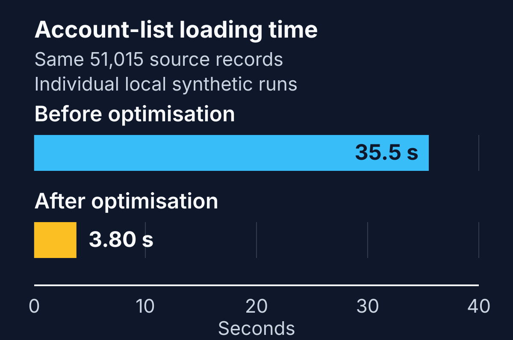

# Batch Overhead Amplification

How smaller batches uncover performance bottlenecks

A proposed repair cut a banking app’s account-list loading time from **more than half a minute to a few seconds** in a local test.

